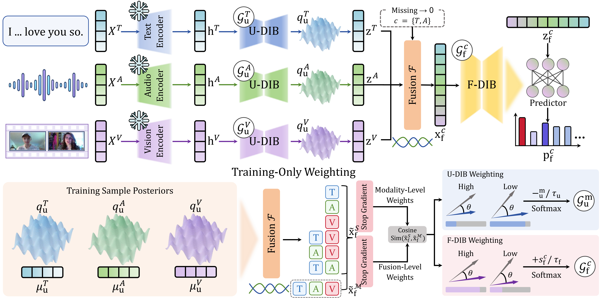

<h1 align="center">[D<sup>2</sup>IB] Differentiated Dual-Level Information Bottleneck for Imperfect Multimodal Emotion Recognition</h1>

## 📌 Abstract

Multimodal Emotion Recognition (MER) often suffers from missing and corrupted modalities in real-world applications. Existing methods for incomplete MER primarily focus on missing modalities but pay less attention to noise in observed ones, which limits their robustness in practical imperfect environments. The Information Bottleneck (IB) principle offers a principled way to suppress noisy information. However, current IB-based methods apply uniform compression across modalities and modality combinations, ignoring differences in their reliability and learning difficulty. To address this issue, we propose a Differentiated Dual-Level Information Bottleneck (D<sup>2</sup>IB) framework. Our approach contains two components: the Unimodal-level DIB (U-DIB) compresses weaker modalities more strongly to filter noise before fusion, and the Fusion-level DIB (F-DIB) regularizes fused representations while guiding weaker modality combinations using a full-modality reference. Both bottlenecks are integrated into the main prediction path, enabling adaptive noise suppression at both levels. Experiments on multiple MER benchmark datasets show that D<sup>2</sup>IB effectively mitigates the degradation in prediction performance caused by the combined effects of missing modalities and noise in the available modalities, demonstrating greater robustness.

## 🎇 Method Overview

<p align="center">
  
</p>

## 🚀 Installation & Usage

### 1. Environment

```bash
pip install -r Requirements.txt
```

### 2. Dataset Preparation

Set `DDIB_DATA_DIR` to the directory containing the dataset folders. The loaders expect the following layout:

```text
DDIB_DATA_DIR/
├── CMUMOSI/
│   ├── CMUMOSI_features_raw_2way.pkl
│   └── features/
│       ├── wav2vec-large-c-UTT/
│       ├── deberta-large-4-UTT/
│       └── manet_UTT/
├── CMUMOSEI/
│   ├── CMUMOSEI_features_raw_2way.pkl
│   └── features/
│       ├── wav2vec-large-c-UTT/
│       ├── deberta-large-4-UTT/
│       └── manet_UTT/
└── IEMOCAP/
    ├── IEMOCAP_features_raw_4way.pkl
    ├── IEMOCAP_features_raw_6way.pkl
    └── features/
        ├── wav2vec-large-c-UTT/
        ├── deberta-large-4-UTT/
        └── manet_UTT/
```

### 3. Training

```bash
export DDIB_DATA_DIR=/path/to/data

# CMU-MOSI, seeds 42, 66, and 100
bash MOSI_3Seed.sh

# CMU-MOSEI, seeds 42, 66, and 100
bash MOSEI_3Seed.sh

# IEMOCAP four-class, five folds
bash IEMOCAP_5Fold.sh

# IEMOCAP six-class, five folds
DATASET=IEMOCAPSIX bash IEMOCAP_5Fold.sh
```

## 📂 Outputs

`logs/{mosi_3seed,mosei_3seed_all,iemocap_5fold_all}/`
